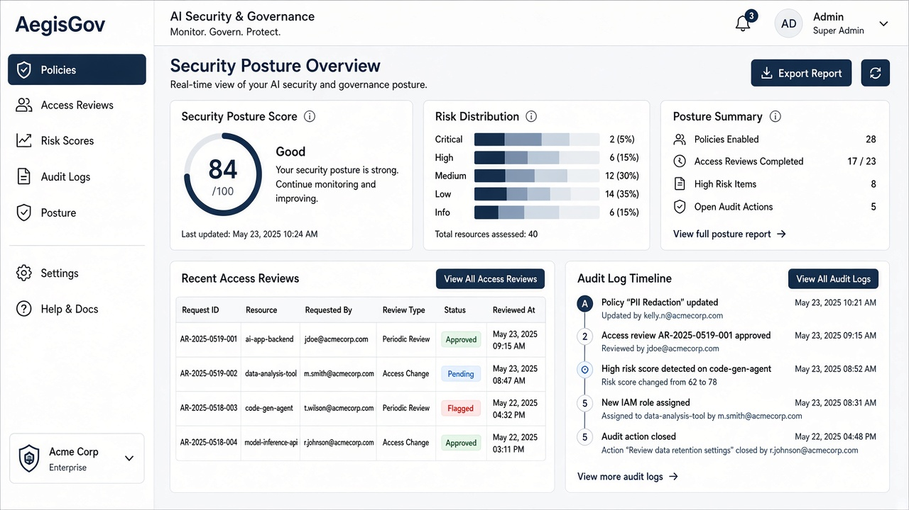

# AI Security & Governance Tool (AegisGov)



**SEO title:** AI Security & Governance Tool — Policy Enforcement, Access Reviews & Posture  
**SEO description:** AI security and governance tool for policy enforcement, access reviews, risk scoring, audit logs, and continuous security posture management.

**Keywords:** `AI security governance`, `policy enforcement`, `access reviews`, `risk scoring`, `audit logs`, `security posture management`, `AI asset inventory`, `Laravel Filament GRC`

---

## Why this product

Spreadsheets cannot govern production AI. **AegisGov** centralizes policy libraries, enforcement findings, access-review campaigns, composite risk scores, immutable audit logs, and continuous posture checks — with modules you can turn on or off per business unit.

### Business ROI / time saver

| Pain today | With AegisGov |
|---|---|
| Policies in Notion / Drive | Versioned policy library with enforcement flags |
| Annual access reviews in Excel | Campaign workflows with flags and due dates |
| Guessing model risk | Scored assessments tied to AI assets |
| No investigator trail | Immutable audit event stream |
| Tool sprawl | Toggle only the modules your program needs |

**Demo model:** reclaim **~80–100 hours/week** across enabled modules at blended security-ops rates, tracked against platform cost on the pricing page and admin widgets.

---

## Stack

- PHP Laravel 13 + Filament 5 admin (accent `#334155`)
- Modular feature flags (`config/modules.php` + Modules UI)
- Multi-role users: Super Admin, Admin, Manager, Staff, Client/Customer, Demo
- Public marketing pages for features, modules, policies, reviews, posture, pricing, demo
- Docker Compose (app + MySQL)
- Packagist packages from [imrandevbd](https://packagist.org/packages/imrandevbd/)

### Required packages

- `imrandevbd/drutogoti` — speed layer
- `imrandevbd/laravel-admin-panel` — admin panel foundations
- `imrandevbd/laravel-ai-catalog` — catalog / scrape assist for policy sources
- `imrandevbd/laravel-ai-hub` — AI governance assist wiring
- `imrandevbd/laravel-attendance-hub` — optional access / attendance bridge
- `imrandevbd/laravel-unicode-pdf` — multilingual audit PDF packs
- `imrandevbd/laravel-universal-slug` — Unicode-safe slugs for policies & assets

**Laravel 13 note:** Packagist builds of `drutogoti`, `laravel-admin-panel`, `laravel-attendance-hub`, and `laravel-ai-catalog` may pin older Illuminate ranges. This repo vendors L13-compatible path bridges under `packages/*` so all seven packages remain declared and `composer install` succeeds. `laravel-ai-hub`, `laravel-unicode-pdf`, and `laravel-universal-slug` install from Packagist when compatible.

---

## Modules (toggle on/off)

| Key | Module | Default | Core |
|---|---|---|---|
| `policies` | Policy Library | ON | Yes |
| `policy_enforcement` | Policy Enforcement | ON | Yes |
| `access_reviews` | Access Reviews | ON | Yes |
| `risk_scoring` | Risk Scoring | ON | Yes |
| `audit_logs` | Audit Logs | ON | Yes |
| `posture` | Security Posture | ON | Yes |
| `ai_inventory` | AI Asset Inventory | ON | No |
| `ai_assist` | AI Governance Assist | ON | No |
| `pdf_packs` | Unicode PDF Packs | ON | No |
| `catalog_scrape` | Policy Catalog Scraper | OFF | No |
| `attendance_bridge` | Access Attendance Bridge | OFF | No |
| `speed_optimizer` | Drutogoti Speed Layer | ON | No |

---

## Domain features

- **Governance policies** — AI use, access, privacy, retention, vendor model rules
- **Policy violations** — severity, investigation status, asset linkage
- **Access reviews** — entitlement campaigns with reviewer and flag counts
- **Risk assessments** — scored subjects with mitigation recommendations
- **Audit logs** — actor, action, payload, severity, occurred_at
- **Posture checks** — identity / data / model / network / vendor domains
- **AI inventory** — models, agents, RAG, integrations with classification tags
- **Multi-role Filament admin** — resources gated by module toggles

---

## Public pages

| Route | Purpose |
|---|---|
| `/` | Hero + KPIs + policy snapshot + dashboard image |
| `/features` | Feature catalog by module category |
| `/modules` | Full module toggle matrix |
| `/policies` | Published policy library |
| `/reviews` | Access reviews + risk scores |
| `/posture` | Posture checks, AI inventory, audit trail |
| `/pricing` | ROI / pricing tiers |
| `/demo` | Demo credentials |
| `/admin` | Filament admin panel |

---

## Demo users

Password for all seeded users: `password` (or `DEMO_USER_PASSWORD`)

| Role | Email |
|---|---|
| Super Admin | superadmin@ai-security-gov.test |
| Admin | admin@ai-security-gov.test |
| Manager | manager@ai-security-gov.test |
| Staff | staff@ai-security-gov.test |
| Client | client@ai-security-gov.test |
| Demo | demo@ai-security-gov.test |

---

## Quick start

```bash
composer install
cp .env.example .env
php artisan key:generate
touch database/database.sqlite
php artisan migrate --seed
php artisan serve
```

Admin: http://127.0.0.1:8000/admin · Marketing: http://127.0.0.1:8000

### Docker

```bash
docker compose up --build
```

App on http://localhost:8080 · MySQL on host port 3309.

---

## Author

**Imran Ahmed** · [me@imrandev.bd](mailto:me@imrandev.bd) · [https://imrandev.bd](https://imrandev.bd)

---

## 🤝 Let's Connect & Collaborate

I am open to Senior Remote Full-Stack Roles, AI Platform Architecture Contracts, and Enterprise Technical Advisory.

Timezone: UTC+6 (Dhaka / Rangpur, Bangladesh) — Flexible overlap with US, UK, and European business hours.

Delivery Mode: Async-ready, Slack, Discord, Jira, GitHub, and production-first accountability.

| Channel | Address / Handle | Quick Action |
|---|---|---|
| 🌐 Primary Portfolio | [imrandev.bd](https://imrandev.bd) | [Visit Site ↗](https://imrandev.bd) |
| 📦 Packagist Packages | [packagist.org/packages/imrandevbd/](https://packagist.org/packages/imrandevbd/) | [View Packages ↗](https://packagist.org/packages/imrandevbd/) |
| 💼 LinkedIn Profile | [linkedin.com/in/imranbru99](https://linkedin.com/in/imranbru99) | [Connect ↗](https://linkedin.com/in/imranbru99) |
| 🐙 GitHub Profile | [github.com/imranbru99](https://github.com/imranbru99) | [Follow ↗](https://github.com/imranbru99) |
| 💬 WhatsApp Direct | +880 1576-918420 | [Chat Now ↗](https://wa.me/8801576918420) |
| 📧 Direct Email | me@imrandev.bd | [Send Email ↗](mailto:me@imrandev.bd) |
| 🐦 X (Twitter) | [@imrandev_bd](https://x.com/imrandev_bd) | [Follow ↗](https://x.com/imrandev_bd) |
| 📺 YouTube Tech | [@ImranDevBD](https://youtube.com/@ImranDevBD) | [Subscribe ↗](https://youtube.com/@ImranDevBD) |
